# Modelo Oracle — FASE 1

54 tablas de negocio, más `VERSION_ESQUEMA` y `PRUEBA_INFRAESTRUCTURA` conservadas de FASE 0.
Las migraciones V001–V016 se agrupan por dominio y se ejecutan después de V000. Los diagramas
incluyen referencias entre dominios; se omiten las flechas de auditoría para facilitar su lectura.
El SQL de `db/migrations/` es la definición exacta de nulabilidad, valores por defecto y restricciones.

## Convenciones y diccionario común

| Columna/tipo                                       | Significado                                                                                                       |
| -------------------------------------------------- | ----------------------------------------------------------------------------------------------------------------- |
| `ID_<ENTIDAD> NUMBER GENERATED ALWAYS AS IDENTITY` | Clave primaria asignada exclusivamente por Oracle.                                                                |
| `CREADO_POR NUMBER`                                | FK a USUARIOS; nulo representa instalación o proceso del sistema, nunca un usuario ficticio.                      |
| `FECHA_CREACION DATE`                              | Fecha/hora de Guatemala asignada por Oracle.                                                                      |
| `MODIFICADO_POR NUMBER`                            | FK al último usuario que cambió la fila; la futura capa de servicio la establece.                                 |
| `FECHA_MODIFICACION DATE`                          | Un trigger la actualiza en cada UPDATE; no puede preceder a la creación.                                          |
| `ACTIVO NUMBER(1)`                                 | 1 vigente, 0 baja lógica; conserva claves únicas e historial.                                                     |
| `NUMBER(12,2)`                                     | Dinero en quetzales; los cálculos futuros usarán decimal.js y redondeo half-up.                                   |
| `NUMBER(18,6)`                                     | Parámetro genérico o copia de parámetro: precisión común para porcentajes, fracciones y valores de configuración. |
| `DATE`                                             | Fecha o fecha/hora local sin zona: America/Guatemala. Fechas civiles se envían a medianoche.                      |
| `RAW(32)`                                          | Hash SHA-256; no contiene el token ni el archivo en claro.                                                        |
| `CLOB ... IS JSON`                                 | Documento JSON comprobado por Oracle, para snapshots, variables y cambios auditados.                              |

Todos los FK tienen índices B-tree con **todas sus columnas al inicio**, incluidos FK compuestos,
creador y editor. PK/UNIQUE también proporcionan índices cuando cubren el acceso. `db/filtros.json`
contiene la lista blanca inicial de filtros por tabla; la prueba de BD verifica cada índice.
En la futura API, búsquedas de texto serán exactas, por rango o por prefijo compatible con estos
índices; búsquedas por subcadena/normalización requieren revisar el plan y añadir un índice apropiado.
No se indexan CLOB, contraseñas ni cuentas bancarias para búsquedas. ACTIVO y FECHA_CREACION están
indexados en cada tabla de negocio. Nuevos filtros exigirán una migración de índice.

BITACORA_AUDITORIA es inmutable: conserva columnas comunes por uniformidad, pero ACTIVO siempre
vale 1 y no admite UPDATE/DELETE. Las correcciones son nuevas entradas. VERSION_ESQUEMA es
metadata técnica permanente con fechas TIMESTAMP WITH TIME ZONE y sin baja lógica. V000 conserva
sus columnas técnicas originales y checksum; no se reescribe una migración aplicada.

## Infraestructura conservada

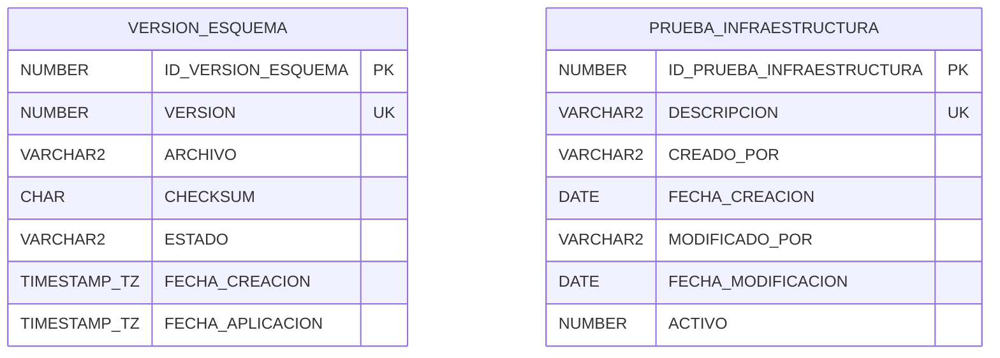

`VERSION_ESQUEMA`: versión numérica única, archivo, SHA-256 y estado APLICANDO/APLICADA/FALLIDA.
`PRUEBA_INFRAESTRUCTURA`: un registro técnico único por descripción; auditoría original con nombre
Oracle en VARCHAR2 y baja lógica. No contiene datos de empleados ni se usa en los CRUD de negocio.

## 1. Seguridad

Migración: [V001__seguridad.sql](../db/migrations/V001__seguridad.sql).

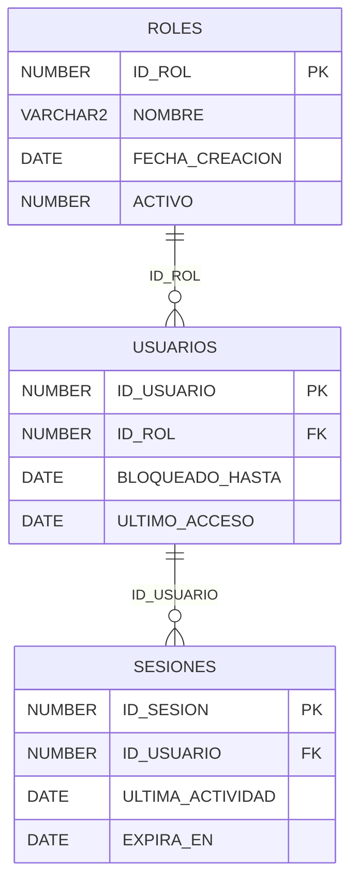

| Tabla y PK                  | Propósito                                                             | Campos de dominio (tipo; `?` admite NULL)                                                                                                                                                                                                                |
| --------------------------- | --------------------------------------------------------------------- | -------------------------------------------------------------------------------------------------------------------------------------------------------------------------------------------------------------------------------------------------------- |
| **ROLES** / `ID_ROL`        | Roles de acceso: ADMIN, RH y EMPLEADO.                                | `CODIGO`: VARCHAR2(40); `NOMBRE`: VARCHAR2(120); `DESCRIPCION`: VARCHAR2(500)?                                                                                                                                                                           |
| **USUARIOS** / `ID_USUARIO` | Identidad, credencial argon2id, bloqueo y cambio inicial obligatorio. | `ID_ROL`: NUMBER; `USUARIO`: VARCHAR2(80); `CORREO`: VARCHAR2(254); `CONTRASENA_HASH`: VARCHAR2(255); `CAMBIO_OBLIGATORIO`: NUMBER(1); `INTENTOS_FALLIDOS`: NUMBER(2); `BLOQUEADO_HASTA`: DATE?; `ULTIMO_ACCESO`: DATE?; `CONTRASENA_CAMBIADA_EN`: DATE? |
| **SESIONES** / `ID_SESION`  | Solo hashes SHA-256 de sesión y CSRF; actividad y revocación.         | `ID_USUARIO`: NUMBER; `TOKEN_HASH`: RAW(32); `CSRF_HASH`: RAW(32); `ULTIMA_ACTIVIDAD`: DATE; `EXPIRA_EN`: DATE; `REVOCADA_EN`: DATE?; `IP`: VARCHAR2(45)?; `AGENTE_USUARIO`: VARCHAR2(500)?                                                              |

## 2. Organización

Migración: [V002__organizacion.sql](../db/migrations/V002__organizacion.sql).

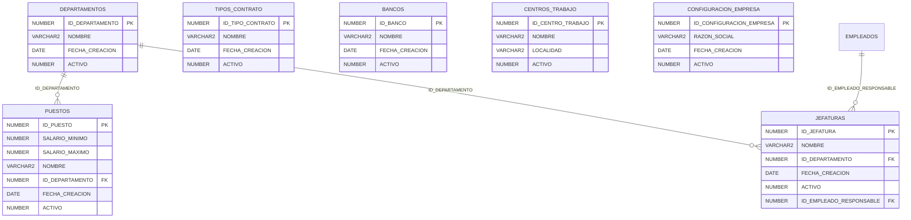

| Tabla y PK                                             | Propósito                                                                | Campos de dominio (tipo; `?` admite NULL)                                                                                                                           |
| ------------------------------------------------------ | ------------------------------------------------------------------------ | ------------------------------------------------------------------------------------------------------------------------------------------------------------------- |
| **DEPARTAMENTOS** / `ID_DEPARTAMENTO`                  | Unidades organizativas reales, sin departamentos ficticios.              | `CODIGO`: VARCHAR2(40); `NOMBRE`: VARCHAR2(120); `DESCRIPCION`: VARCHAR2(500)?                                                                                      |
| **PUESTOS** / `ID_PUESTO`                              | Puestos pertenecientes a un departamento.                                | `CODIGO`: VARCHAR2(40); `NOMBRE`: VARCHAR2(120); `DESCRIPCION`: VARCHAR2(500)?; `ID_DEPARTAMENTO`: NUMBER                                                           |
| **JEFATURAS** / `ID_JEFATURA`                          | Jefatura por departamento; responsable opcional después de empleados.    | `CODIGO`: VARCHAR2(40); `NOMBRE`: VARCHAR2(120); `DESCRIPCION`: VARCHAR2(500)?; `ID_DEPARTAMENTO`: NUMBER; `ID_EMPLEADO_RESPONSABLE`: NUMBER?                       |
| **TIPOS_CONTRATO** / `ID_TIPO_CONTRATO`                | Modalidades contractuales.                                               | `CODIGO`: VARCHAR2(40); `NOMBRE`: VARCHAR2(120); `DESCRIPCION`: VARCHAR2(500)?; `REQUIERE_FIN`: NUMBER(1)                                                           |
| **BANCOS** / `ID_BANCO`                                | Catálogo de bancos; se carga con datos de la empresa, sin seed ficticio. | `CODIGO`: VARCHAR2(40); `NOMBRE`: VARCHAR2(120); `DESCRIPCION`: VARCHAR2(500)?                                                                                      |
| **CENTROS_TRABAJO** / `ID_CENTRO_TRABAJO`              | Sede y localidad para aplicar feriados locales.                          | `CODIGO`: VARCHAR2(40); `NOMBRE`: VARCHAR2(120); `DESCRIPCION`: VARCHAR2(500)?; `LOCALIDAD`: VARCHAR2(120); `DIRECCION`: VARCHAR2(500)?                             |
| **CONFIGURACION_EMPRESA** / `ID_CONFIGURACION_EMPRESA` | Datos institucionales para documentos; una fila activa.                  | `RAZON_SOCIAL`: VARCHAR2(200); `NIT`: VARCHAR2(20); `DIRECCION`: VARCHAR2(500); `REPRESENTANTE`: VARCHAR2(200)?; `CORREO`: VARCHAR2(254)?; `TELEFONO`: VARCHAR2(8)? |

## 3. Empleados

Migración: [V003__empleados.sql](../db/migrations/V003__empleados.sql).

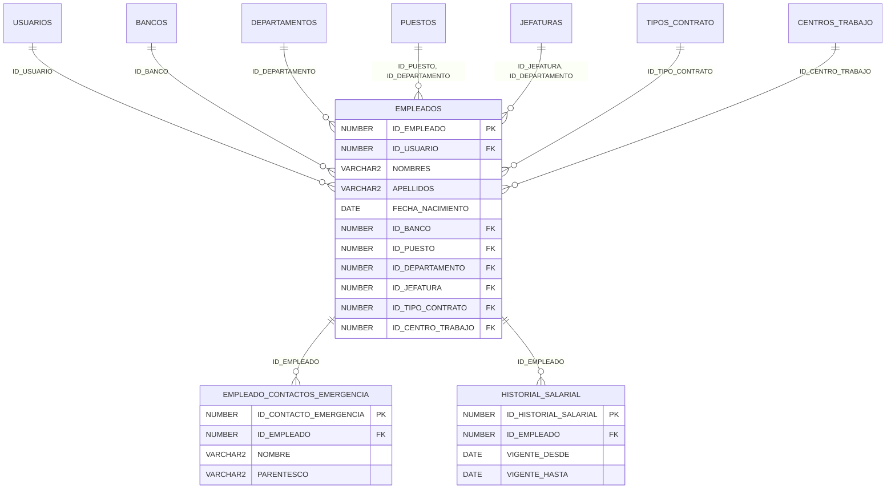

| Tabla y PK                                                   | Propósito                                                               | Campos de dominio (tipo; `?` admite NULL)                                                                                                                                                                                                                                                                                                                                                                                                                                                                                                                                                                                                                                                            |
| ------------------------------------------------------------ | ----------------------------------------------------------------------- | ---------------------------------------------------------------------------------------------------------------------------------------------------------------------------------------------------------------------------------------------------------------------------------------------------------------------------------------------------------------------------------------------------------------------------------------------------------------------------------------------------------------------------------------------------------------------------------------------------------------------------------------------------------------------------------------------------- |
| **EMPLEADOS** / `ID_EMPLEADO`                                | Expediente y pertenencia organizativa; salario y horario por historial. | `ID_USUARIO`: NUMBER?; `CODIGO`: VARCHAR2(40); `NOMBRES`: VARCHAR2(100); `APELLIDOS`: VARCHAR2(100); `DPI`: VARCHAR2(13); `NIT`: VARCHAR2(20); `AFILIACION_IGSS`: VARCHAR2(20)?; `FECHA_NACIMIENTO`: DATE; `SEXO`: VARCHAR2(1); `ESTADO_CIVIL`: VARCHAR2(20); `DIRECCION`: VARCHAR2(500); `TELEFONO`: VARCHAR2(8); `CORREO`: VARCHAR2(254); `ID_BANCO`: NUMBER?; `CUENTA_BANCARIA`: VARCHAR2(34)?; `TIPO_CUENTA`: VARCHAR2(15)?; `ID_PUESTO`: NUMBER; `ID_DEPARTAMENTO`: NUMBER; `ID_JEFATURA`: NUMBER?; `ID_TIPO_CONTRATO`: NUMBER; `ID_CENTRO_TRABAJO`: NUMBER; `FECHA_INGRESO`: DATE; `FECHA_FIN_CONTRATO`: DATE?; `FECHA_EGRESO`: DATE?; `MOTIVO_EGRESO`: VARCHAR2(500)?; `ESTADO`: VARCHAR2(15) |
| **EMPLEADO_CONTACTOS_EMERGENCIA** / `ID_CONTACTO_EMERGENCIA` | Varios contactos por empleado; prioridad única.                         | `ID_EMPLEADO`: NUMBER; `NOMBRE`: VARCHAR2(200); `PARENTESCO`: VARCHAR2(60); `TELEFONO`: VARCHAR2(8); `PRIORIDAD`: NUMBER(2)                                                                                                                                                                                                                                                                                                                                                                                                                                                                                                                                                                          |
| **HISTORIAL_SALARIAL** / `ID_HISTORIAL_SALARIAL`             | Salario mensual vigente; no se duplica en empleados.                    | `ID_EMPLEADO`: NUMBER; `SALARIO_BASE`: NUMBER(12,2); `VIGENTE_DESDE`: DATE; `VIGENTE_HASTA`: DATE?; `MOTIVO`: VARCHAR2(500)                                                                                                                                                                                                                                                                                                                                                                                                                                                                                                                                                                          |

## 4. Horarios y calendario

Migración: [V004__horarios_calendario.sql](../db/migrations/V004__horarios_calendario.sql).

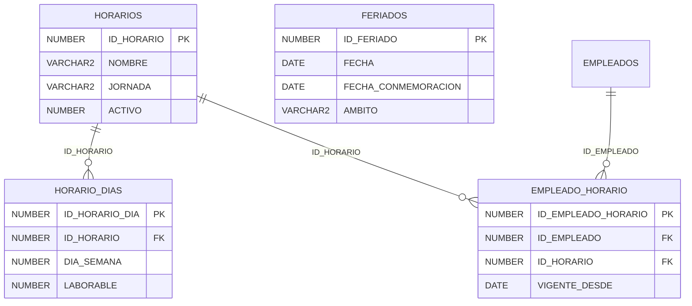

| Tabla y PK                                   | Propósito                                                             | Campos de dominio (tipo; `?` admite NULL)                                                                                                                                                                                         |
| -------------------------------------------- | --------------------------------------------------------------------- | --------------------------------------------------------------------------------------------------------------------------------------------------------------------------------------------------------------------------------- |
| **HORARIOS** / `ID_HORARIO`                  | Patrón semanal; horas legales por jornada en parámetros.              | `CODIGO`: VARCHAR2(40); `NOMBRE`: VARCHAR2(120); `DESCRIPCION`: VARCHAR2(500)?; `JORNADA`: VARCHAR2(10)                                                                                                                           |
| **HORARIO_DIAS** / `ID_HORARIO_DIA`          | ISO lunes=1, domingo=7; minutos desde medianoche, con cruce nocturno. | `ID_HORARIO`: NUMBER; `DIA_SEMANA`: NUMBER(1); `LABORABLE`: NUMBER(1); `MINUTO_ENTRADA`: NUMBER(4)?; `MINUTO_SALIDA`: NUMBER(4)?; `CRUZA_MEDIANOCHE`: NUMBER(1); `MINUTOS_DESCANSO`: NUMBER(4)                                    |
| **EMPLEADO_HORARIO** / `ID_EMPLEADO_HORARIO` | Asignación de horario con vigencia.                                   | `ID_EMPLEADO`: NUMBER; `ID_HORARIO`: NUMBER; `VIGENTE_DESDE`: DATE; `VIGENTE_HASTA`: DATE?; `MOTIVO`: VARCHAR2(500)                                                                                                               |
| **FERIADOS** / `ID_FERIADO`                  | Fecha efectiva, fecha nominal, ámbito y franja para medios días.      | `CODIGO`: VARCHAR2(60); `NOMBRE`: VARCHAR2(120); `FECHA`: DATE; `FECHA_CONMEMORACION`: DATE; `AMBITO`: VARCHAR2(10); `LOCALIDAD`: VARCHAR2(120); `MINUTO_INICIO`: NUMBER(4); `MINUTO_FIN`: NUMBER(4); `FUNDAMENTO`: VARCHAR2(500) |

## 5. Parámetros legales

Migración: [V005__parametros_legales.sql](../db/migrations/V005__parametros_legales.sql).

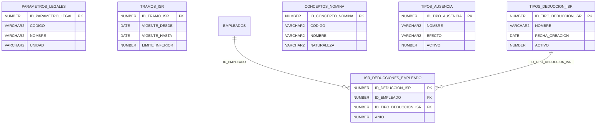

| Tabla y PK                                        | Propósito                                                                     | Campos de dominio (tipo; `?` admite NULL)                                                                                                                                                                       |
| ------------------------------------------------- | ----------------------------------------------------------------------------- | --------------------------------------------------------------------------------------------------------------------------------------------------------------------------------------------------------------- |
| **PARAMETROS_LEGALES** / `ID_PARAMETRO_LEGAL`     | Valores numéricos con vigencia, unidad y fundamento; tasas como porcentaje.   | `CODIGO`: VARCHAR2(60); `NOMBRE`: VARCHAR2(150); `VALOR`: NUMBER(18,6); `UNIDAD`: VARCHAR2(20); `VIGENTE_DESDE`: DATE; `VIGENTE_HASTA`: DATE?; `FUNDAMENTO`: VARCHAR2(500); `MOTIVO`: VARCHAR2(500)             |
| **TRAMOS_ISR** / `ID_TRAMO_ISR`                   | Escala marginal con cuota fija y vigencia; último límite superior nulo.       | `VIGENTE_DESDE`: DATE; `VIGENTE_HASTA`: DATE?; `LIMITE_INFERIOR`: NUMBER(12,2); `LIMITE_SUPERIOR`: NUMBER(12,2)?; `TASA_PORCENTAJE`: NUMBER(7,4); `CUOTA_FIJA`: NUMBER(12,2); `MOTIVO`: VARCHAR2(500)           |
| **TIPOS_DEDUCCION_ISR** / `ID_TIPO_DEDUCCION_ISR` | Deducciones acreditadas; tope se resuelve con parámetro vigente.              | `CODIGO`: VARCHAR2(40); `NOMBRE`: VARCHAR2(120); `DESCRIPCION`: VARCHAR2(500)?; `CODIGO_PARAMETRO_TOPE`: VARCHAR2(60)?                                                                                          |
| **ISR_DEDUCCIONES_EMPLEADO** / `ID_DEDUCCION_ISR` | Soportes por empleado, año fiscal y tipo; IGSS de planilla se acumula aparte. | `ID_EMPLEADO`: NUMBER; `ID_TIPO_DEDUCCION_ISR`: NUMBER; `ANIO`: NUMBER(4); `MONTO`: NUMBER(12,2); `REFERENCIA`: VARCHAR2(100); `FECHA_COMPROBANTE`: DATE; `RUTA_SOPORTE`: VARCHAR2(500)?                        |
| **CONCEPTOS_NOMINA** / `ID_CONCEPTO_NOMINA`       | Conceptos versionados: banderas vigentes y código estable.                    | `CODIGO`: VARCHAR2(40); `NOMBRE`: VARCHAR2(120); `NATURALEZA`: VARCHAR2(10); `AFECTA_IGSS`: NUMBER(1); `AFECTA_ISR`: NUMBER(1); `AFECTA_PRESTACIONES`: NUMBER(1); `VIGENTE_DESDE`: DATE; `VIGENTE_HASTA`: DATE? |
| **TIPOS_AUSENCIA** / `ID_TIPO_AUSENCIA`           | Efecto en salario configurable por tipo.                                      | `CODIGO`: VARCHAR2(40); `NOMBRE`: VARCHAR2(120); `DESCRIPCION`: VARCHAR2(500)?; `EFECTO`: VARCHAR2(15)                                                                                                          |

## 6. Descuentos y préstamos

Migración: [V006__descuentos_prestamos.sql](../db/migrations/V006__descuentos_prestamos.sql).

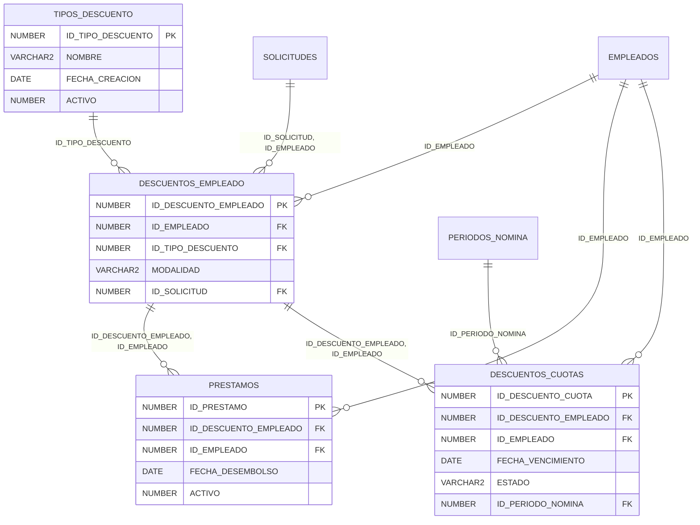

| Tabla y PK                                        | Propósito                                                                 | Campos de dominio (tipo; `?` admite NULL)                                                                                                                                                                                                                                                                            |
| ------------------------------------------------- | ------------------------------------------------------------------------- | -------------------------------------------------------------------------------------------------------------------------------------------------------------------------------------------------------------------------------------------------------------------------------------------------------------------- |
| **TIPOS_DESCUENTO** / `ID_TIPO_DESCUENTO`         | Préstamo, anticipo, embargo, parqueo, consumo en tienda y otros.          | `CODIGO`: VARCHAR2(40); `NOMBRE`: VARCHAR2(120); `DESCRIPCION`: VARCHAR2(500)?                                                                                                                                                                                                                                       |
| **DESCUENTOS_EMPLEADO** / `ID_DESCUENTO_EMPLEADO` | Acuerdo de descuento; cuotas, fijo o único con saldo controlado.          | `ID_EMPLEADO`: NUMBER; `ID_TIPO_DESCUENTO`: NUMBER; `MODALIDAD`: VARCHAR2(10); `MONTO_QUINCENA`: NUMBER(12,2); `MONTO_TOTAL`: NUMBER(12,2)?; `SALDO`: NUMBER(12,2)?; `NUMERO_CUOTAS`: NUMBER(5)?; `FECHA_INICIO`: DATE; `FECHA_FIN`: DATE?; `ESTADO`: VARCHAR2(15); `MOTIVO`: VARCHAR2(500); `ID_SOLICITUD`: NUMBER? |
| **PRESTAMOS** / `ID_PRESTAMO`                     | Origen de un descuento en cuotas; importe total incluye interés acordado. | `ID_DESCUENTO_EMPLEADO`: NUMBER; `ID_EMPLEADO`: NUMBER; `CAPITAL`: NUMBER(12,2); `INTERES_TOTAL`: NUMBER(12,2); `FECHA_DESEMBOLSO`: DATE; `REFERENCIA`: VARCHAR2(100)                                                                                                                                                |
| **DESCUENTOS_CUOTAS** / `ID_DESCUENTO_CUOTA`      | Calendario y saldo por cuota; periodo y nómina vinculados en V007.        | `ID_DESCUENTO_EMPLEADO`: NUMBER; `ID_EMPLEADO`: NUMBER; `NUMERO_CUOTA`: NUMBER(5); `FECHA_VENCIMIENTO`: DATE; `MONTO`: NUMBER(12,2); `MONTO_PAGADO`: NUMBER(12,2); `ESTADO`: VARCHAR2(12); `FECHA_PAGO`: DATE?; `ID_PERIODO_NOMINA`: NUMBER?                                                                         |

## 7. Nómina

Migración: [V007__nomina.sql](../db/migrations/V007__nomina.sql).

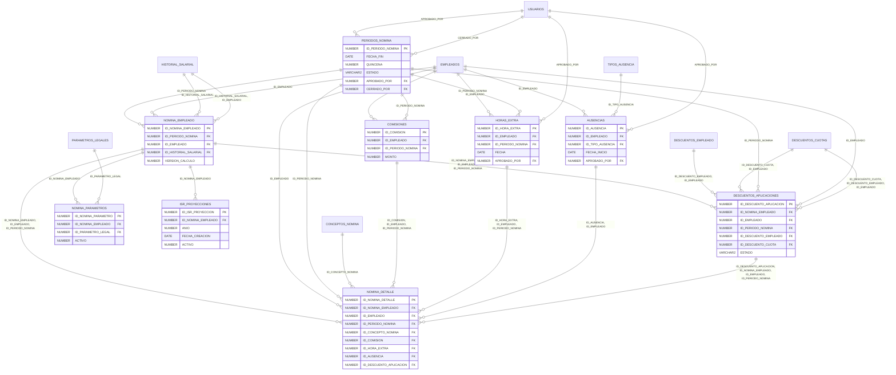

| Tabla y PK                                              | Propósito                                                                       | Campos de dominio (tipo; `?` admite NULL)                                                                                                                                                                                                                                                                                                                                                                                                                                                                       |
| ------------------------------------------------------- | ------------------------------------------------------------------------------- | --------------------------------------------------------------------------------------------------------------------------------------------------------------------------------------------------------------------------------------------------------------------------------------------------------------------------------------------------------------------------------------------------------------------------------------------------------------------------------------------------------------- |
| **PERIODOS_NOMINA** / `ID_PERIODO_NOMINA`               | Quincenas exactas, no superponibles por fecha inicial única y límites rígidos.  | `FECHA_INICIO`: DATE; `FECHA_FIN`: DATE; `QUINCENA`: NUMBER(1); `ESTADO`: VARCHAR2(12); `VERSION_CALCULO`: NUMBER(5); `CALCULADO_EN`: DATE?; `REVISADO_EN`: DATE?; `APROBADO_EN`: DATE?; `CERRADO_EN`: DATE?; `APROBADO_POR`: NUMBER?; `CERRADO_POR`: NUMBER?; `MOTIVO_REAPERTURA`: VARCHAR2(500)?                                                                                                                                                                                                              |
| **COMISIONES** / `ID_COMISION`                          | Comisiones manuales por empleado y quincena, con referencia idempotente.        | `ID_EMPLEADO`: NUMBER; `ID_PERIODO_NOMINA`: NUMBER; `MONTO`: NUMBER(12,2); `REFERENCIA`: VARCHAR2(100); `DESCRIPCION`: VARCHAR2(500)                                                                                                                                                                                                                                                                                                                                                                            |
| **HORAS_EXTRA** / `ID_HORA_EXTRA`                       | Tiempo extra aprobado; factor y valor hora se congelan al calcular nómina.      | `ID_EMPLEADO`: NUMBER; `ID_PERIODO_NOMINA`: NUMBER; `FECHA`: DATE; `HORAS`: NUMBER(6,2); `ESTADO`: VARCHAR2(12); `APROBADO_POR`: NUMBER?; `MOTIVO`: VARCHAR2(500)                                                                                                                                                                                                                                                                                                                                               |
| **AUSENCIAS** / `ID_AUSENCIA`                           | Ausencias, permisos e incapacidades por rango; pueden cruzar periodos.          | `ID_EMPLEADO`: NUMBER; `ID_TIPO_AUSENCIA`: NUMBER; `FECHA_INICIO`: DATE; `FECHA_FIN`: DATE; `DIAS`: NUMBER(7,2); `ESTADO`: VARCHAR2(12); `MOTIVO`: VARCHAR2(500); `RUTA_SOPORTE`: VARCHAR2(500)?; `APROBADO_POR`: NUMBER?                                                                                                                                                                                                                                                                                       |
| **NOMINA_EMPLEADO** / `ID_NOMINA_EMPLEADO`              | Resultado versionado por empleado/periodo; snapshot del expediente y totales.   | `ID_PERIODO_NOMINA`: NUMBER; `ID_EMPLEADO`: NUMBER; `ID_HISTORIAL_SALARIAL`: NUMBER; `VERSION_CALCULO`: NUMBER(5); `DIAS_PAGADOS`: NUMBER(5,2); `SALARIO_BASE`: NUMBER(12,2); `TOTAL_INGRESOS`: NUMBER(12,2); `TOTAL_DESCUENTOS`: NUMBER(12,2); `NETO`: NUMBER(12,2); `COSTO_PATRONAL`: NUMBER(12,2); `DATOS_EMPLEADO`: CLOB; `FECHA_PAGO`: DATE?; `REFERENCIA_PAGO`: VARCHAR2(100)?                                                                                                                            |
| **DESCUENTOS_APLICACIONES** / `ID_DESCUENTO_APLICACION` | Aplicación/reversión por cálculo; evita perder historial al reabrir.            | `ID_NOMINA_EMPLEADO`: NUMBER; `ID_EMPLEADO`: NUMBER; `ID_PERIODO_NOMINA`: NUMBER; `ID_DESCUENTO_EMPLEADO`: NUMBER; `ID_DESCUENTO_CUOTA`: NUMBER?; `MONTO`: NUMBER(12,2); `SALDO_ANTERIOR`: NUMBER(12,2)?; `SALDO_NUEVO`: NUMBER(12,2)?; `ESTADO`: VARCHAR2(10)                                                                                                                                                                                                                                                  |
| **NOMINA_DETALLE** / `ID_NOMINA_DETALLE`                | Líneas con base, tasa, banderas y origen; snapshot protege periodos anteriores. | `ID_NOMINA_EMPLEADO`: NUMBER; `ID_EMPLEADO`: NUMBER; `ID_PERIODO_NOMINA`: NUMBER; `ID_CONCEPTO_NOMINA`: NUMBER; `ORDEN`: NUMBER(5); `DESCRIPCION`: VARCHAR2(200); `NATURALEZA`: VARCHAR2(10); `BASE_CALCULO`: NUMBER(12,2); `CANTIDAD`: NUMBER(12,4); `TASA_PORCENTAJE`: NUMBER(9,4)?; `MONTO`: NUMBER(12,2); `AFECTA_IGSS`: NUMBER(1); `AFECTA_ISR`: NUMBER(1); `AFECTA_PRESTACIONES`: NUMBER(1); `ID_COMISION`: NUMBER?; `ID_HORA_EXTRA`: NUMBER?; `ID_AUSENCIA`: NUMBER?; `ID_DESCUENTO_APLICACION`: NUMBER? |
| **NOMINA_PARAMETROS** / `ID_NOMINA_PARAMETRO`           | Parámetros y valores exactos utilizados en cada resultado.                      | `ID_NOMINA_EMPLEADO`: NUMBER; `ID_PARAMETRO_LEGAL`: NUMBER; `VALOR_APLICADO`: NUMBER(18,6)                                                                                                                                                                                                                                                                                                                                                                                                                      |
| **ISR_PROYECCIONES** / `ID_ISR_PROYECCION`              | Snapshot por cálculo del ISR anual, acumulado y periodos restantes.             | `ID_NOMINA_EMPLEADO`: NUMBER; `ANIO`: NUMBER(4); `RENTA_ANUAL`: NUMBER(12,2); `DEDUCCION_PERSONAL`: NUMBER(12,2); `DEDUCCIONES_ACREDITADAS`: NUMBER(12,2); `IGSS_PROYECTADO`: NUMBER(12,2); `RENTA_IMPONIBLE`: NUMBER(12,2); `ISR_ANUAL`: NUMBER(12,2); `RETENIDO_ACUMULADO`: NUMBER(12,2); `PERIODOS_RESTANTES`: NUMBER(2); `RETENCION_PERIODO`: NUMBER(12,2); `DETALLE_CALCULO`: CLOB                                                                                                                         |

## 8. Prestaciones

Migración: [V008__prestaciones.sql](../db/migrations/V008__prestaciones.sql).

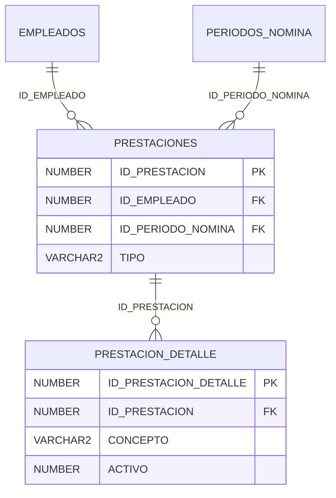

| Tabla y PK                                       | Propósito                                                      | Campos de dominio (tipo; `?` admite NULL)                                                                                                                                                                                                                                                                                                                 |
| ------------------------------------------------ | -------------------------------------------------------------- | --------------------------------------------------------------------------------------------------------------------------------------------------------------------------------------------------------------------------------------------------------------------------------------------------------------------------------------------------------- |
| **PRESTACIONES** / `ID_PRESTACION`               | Liquidaciones de aguinaldo, Bono 14 e indemnización/finiquito. | `ID_EMPLEADO`: NUMBER; `ID_PERIODO_NOMINA`: NUMBER?; `TIPO`: VARCHAR2(15); `FECHA_INICIO_BASE`: DATE; `FECHA_FIN_BASE`: DATE; `FECHA_CALCULO`: DATE; `SALARIO_PROMEDIO`: NUMBER(12,2); `TIEMPO_ANIOS`: NUMBER(10,6); `MONTO_TOTAL`: NUMBER(12,2); `ESTADO`: VARCHAR2(12); `FECHA_PAGO`: DATE?; `REFERENCIA_PAGO`: VARCHAR2(100)?; `MOTIVO`: VARCHAR2(500) |
| **PRESTACION_DETALLE** / `ID_PRESTACION_DETALLE` | Componentes de finiquito, exención, días y bases congeladas.   | `ID_PRESTACION`: NUMBER; `CONCEPTO`: VARCHAR2(40); `BASE_CALCULO`: NUMBER(12,2); `DIAS`: NUMBER(9,4); `MONTO`: NUMBER(12,2); `MONTO_EXENTO_ISR`: NUMBER(12,2); `DETALLE_CALCULO`: CLOB                                                                                                                                                                    |

## 9. Vacaciones

Migraciones: [V009__vacaciones.sql](../db/migrations/V009__vacaciones.sql) y
[V015__vacaciones_saldo_inicial.sql](../db/migrations/V015__vacaciones_saldo_inicial.sql) y
[V026__vacaciones_deterministas_cancelacion.sql](../db/migrations/V026__vacaciones_deterministas_cancelacion.sql).

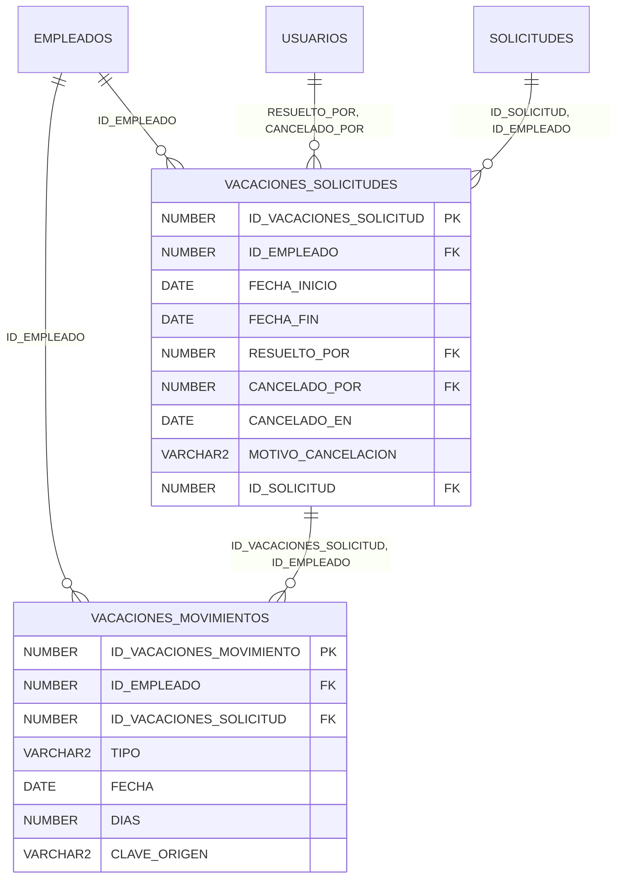

| Tabla y PK                                              | Propósito                                                                      | Campos de dominio (tipo; `?` admite NULL)                                                                                                                                                                                                                                                              |
| ------------------------------------------------------- | ------------------------------------------------------------------------------ | ------------------------------------------------------------------------------------------------------------------------------------------------------------------------------------------------------------------------------------------------------------------------------------------------------ |
| **VACACIONES_SOLICITUDES** / `ID_VACACIONES_SOLICITUD`  | Rango y días laborales al solicitar y resolver; vínculo con solicitud en V010. | `ID_EMPLEADO`: NUMBER; `FECHA_INICIO`: DATE; `FECHA_FIN`: DATE; `DIAS_SOLICITADOS`: NUMBER(7,2); `SALDO_AL_SOLICITAR`: NUMBER(7,2); `SALDO_AL_RESOLVER`: NUMBER(7,2)?; `ESTADO`: VARCHAR2(12); `RESUELTO_POR`: NUMBER?; `RESUELTO_EN`: DATE?; `MOTIVO_RECHAZO`: VARCHAR2(500)?; `ID_SOLICITUD`: NUMBER |
| **VACACIONES_MOVIMIENTOS** / `ID_VACACIONES_MOVIMIENTO` | Kardex con débito/reserva al aprobar; reversión explícita y ajustes motivados. | `ID_EMPLEADO`: NUMBER; `ID_VACACIONES_SOLICITUD`: NUMBER?; `TIPO`: VARCHAR2(15); `FECHA`: DATE; `DIAS`: NUMBER(7,2); `CLAVE_ORIGEN`: VARCHAR2(100); `MOTIVO`: VARCHAR2(500)                                                                                                                            |

## 10. Solicitudes y documentos

Migración: [V010__solicitudes_documentos.sql](../db/migrations/V010__solicitudes_documentos.sql).

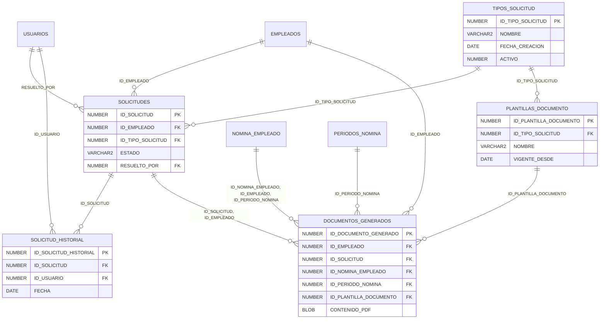

| Tabla y PK                                          | Propósito                                                                     | Campos de dominio (tipo; `?` admite NULL)                                                                                                                                                                                                                                                                                                                                                                              |
| --------------------------------------------------- | ----------------------------------------------------------------------------- | ---------------------------------------------------------------------------------------------------------------------------------------------------------------------------------------------------------------------------------------------------------------------------------------------------------------------------------------------------------------------------------------------------------------------- |
| **TIPOS_SOLICITUD** / `ID_TIPO_SOLICITUD`           | Trámites del portal y requerimiento de documento/PDF.                         | `CODIGO`: VARCHAR2(40); `NOMBRE`: VARCHAR2(120); `DESCRIPCION`: VARCHAR2(500)?; `GENERA_PDF`: NUMBER(1); `ES_DIRECTA`: NUMBER(1)                                                                                                                                                                                                                                                                                       |
| **SOLICITUDES** / `ID_SOLICITUD`                    | Bandeja común, datos críticos propuestos y resolución motivada.               | `ID_EMPLEADO`: NUMBER; `ID_TIPO_SOLICITUD`: NUMBER; `ESTADO`: VARCHAR2(12); `DATOS_SOLICITADOS`: CLOB?; `OBSERVACIONES`: VARCHAR2(1000)?; `RESUELTO_POR`: NUMBER?; `RESUELTO_EN`: DATE?; `MOTIVO_RECHAZO`: VARCHAR2(500)?; `ENTREGADA_EN`: DATE?                                                                                                                                                                       |
| **SOLICITUD_HISTORIAL** / `ID_SOLICITUD_HISTORIAL`  | Transiciones de la solicitud con actor, fecha y motivo.                       | `ID_SOLICITUD`: NUMBER; `ESTADO_ANTERIOR`: VARCHAR2(12)?; `ESTADO_NUEVO`: VARCHAR2(12); `ID_USUARIO`: NUMBER; `FECHA`: DATE; `MOTIVO`: VARCHAR2(1000)?                                                                                                                                                                                                                                                                 |
| **PLANTILLAS_DOCUMENTO** / `ID_PLANTILLA_DOCUMENTO` | Texto editable versionado por trámite; variables permitidas en JSON.          | `ID_TIPO_SOLICITUD`: NUMBER; `CODIGO`: VARCHAR2(40); `VERSION`: NUMBER(5); `NOMBRE`: VARCHAR2(150); `CONTENIDO`: CLOB; `VARIABLES_PERMITIDAS`: CLOB; `VIGENTE_DESDE`: DATE; `VIGENTE_HASTA`: DATE?                                                                                                                                                                                                                     |
| **DOCUMENTOS_GENERADOS** / `ID_DOCUMENTO_GENERADO`  | PDF privado por solicitud o boleta; snapshot de plantilla y hash del archivo. | `ID_EMPLEADO`: NUMBER; `ID_SOLICITUD`: NUMBER?; `ID_NOMINA_EMPLEADO`: NUMBER?; `ID_PERIODO_NOMINA`: NUMBER?; `ID_PLANTILLA_DOCUMENTO`: NUMBER?; `VERSION`: NUMBER(5); `NOMBRE_ARCHIVO`: VARCHAR2(200); `RUTA_PRIVADA`: VARCHAR2(500); `SHA256`: RAW(32); `TAMANIO_BYTES`: NUMBER(12); `CONTENIDO_PLANTILLA`: CLOB?; `VARIABLES_APLICADAS`: CLOB; `CONTENIDO_PDF`: BLOB?; `ESTADO`: VARCHAR2(12); `ENTREGADO_EN`: DATE? |

## 11. Comunicaciones

Migración: [V011__comunicaciones.sql](../db/migrations/V011__comunicaciones.sql).

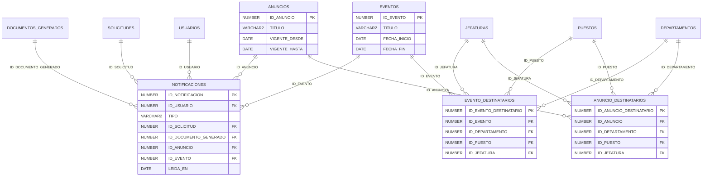

| Tabla y PK                                            | Propósito                                                             | Campos de dominio (tipo; `?` admite NULL)                                                                                                                                                                                                                |
| ----------------------------------------------------- | --------------------------------------------------------------------- | -------------------------------------------------------------------------------------------------------------------------------------------------------------------------------------------------------------------------------------------------------- |
| **ANUNCIOS** / `ID_ANUNCIO`                           | Publicaciones con vigencia y destinatarios todos o grupos.            | `TITULO`: VARCHAR2(200); `CONTENIDO`: CLOB; `VIGENTE_DESDE`: DATE; `VIGENTE_HASTA`: DATE; `PARA_TODOS`: NUMBER(1)                                                                                                                                        |
| **EVENTOS** / `ID_EVENTO`                             | Agenda con inicio y fin local y audiencia segmentable.                | `TITULO`: VARCHAR2(200); `DESCRIPCION`: CLOB?; `FECHA_INICIO`: DATE; `FECHA_FIN`: DATE; `LUGAR`: VARCHAR2(250); `PARA_TODOS`: NUMBER(1)                                                                                                                  |
| **ANUNCIO_DESTINATARIOS** / `ID_ANUNCIO_DESTINATARIO` | Cada fila representa un grupo; varios grupos se unen por OR.          | `ID_ANUNCIO`: NUMBER; `ID_DEPARTAMENTO`: NUMBER?; `ID_PUESTO`: NUMBER?; `ID_JEFATURA`: NUMBER?                                                                                                                                                           |
| **EVENTO_DESTINATARIOS** / `ID_EVENTO_DESTINATARIO`   | Cada fila representa un grupo; varios grupos se unen por OR.          | `ID_EVENTO`: NUMBER; `ID_DEPARTAMENTO`: NUMBER?; `ID_PUESTO`: NUMBER?; `ID_JEFATURA`: NUMBER?                                                                                                                                                            |
| **NOTIFICACIONES** / `ID_NOTIFICACION`                | Campana por usuario y evento, lectura y vínculo al recurso protegido. | `ID_USUARIO`: NUMBER; `TIPO`: VARCHAR2(20); `TITULO`: VARCHAR2(200); `MENSAJE`: VARCHAR2(1000); `CLAVE_EVENTO`: VARCHAR2(120); `ID_SOLICITUD`: NUMBER?; `ID_DOCUMENTO_GENERADO`: NUMBER?; `ID_ANUNCIO`: NUMBER?; `ID_EVENTO`: NUMBER?; `LEIDA_EN`: DATE? |

## 12. Auditoría

Migración: [V012__auditoria.sql](../db/migrations/V012__auditoria.sql).

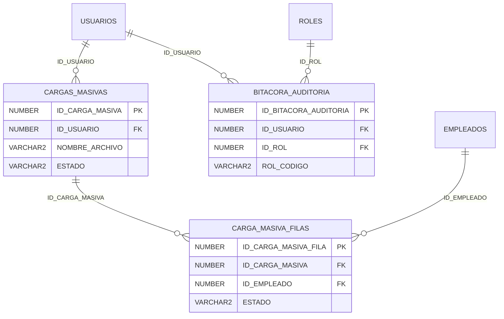

| Tabla y PK                                       | Propósito                                                                 | Campos de dominio (tipo; `?` admite NULL)                                                                                                                                                                                                                                |
| ------------------------------------------------ | ------------------------------------------------------------------------- | ------------------------------------------------------------------------------------------------------------------------------------------------------------------------------------------------------------------------------------------------------------------------ |
| **CARGAS_MASIVAS** / `ID_CARGA_MASIVA`           | Lote de importación y resultados; nunca guarda contraseñas temporales.    | `ID_USUARIO`: NUMBER; `NOMBRE_ARCHIVO`: VARCHAR2(200); `SHA256`: RAW(32); `MODALIDAD`: VARCHAR2(15); `ESTADO`: VARCHAR2(12); `TOTAL_FILAS`: NUMBER(8); `FILAS_VALIDAS`: NUMBER(8); `FILAS_IMPORTADAS`: NUMBER(8); `CONFIRMADA_EN`: DATE?; `RUTA_REPORTE`: VARCHAR2(500)? |
| **CARGA_MASIVA_FILAS** / `ID_CARGA_MASIVA_FILA`  | Validación por fila y empleado creado; datos propuestos sin credenciales. | `ID_CARGA_MASIVA`: NUMBER; `NUMERO_FILA`: NUMBER(8); `DATOS`: CLOB; `ERRORES`: CLOB; `ID_EMPLEADO`: NUMBER?; `ESTADO`: VARCHAR2(12)                                                                                                                                      |
| **BITACORA_AUDITORIA** / `ID_BITACORA_AUDITORIA` | Registro inmutable del actor, rol histórico, acción y cambios depurados.  | `ID_USUARIO`: NUMBER?; `ID_ROL`: NUMBER?; `ROL_CODIGO`: VARCHAR2(10)?; `ACCION`: VARCHAR2(60); `ENTIDAD`: VARCHAR2(60); `ID_ENTIDAD`: NUMBER?; `VALORES_ANTERIORES`: CLOB?; `VALORES_NUEVOS`: CLOB?; `MOTIVO`: VARCHAR2(1000)?; `IP`: VARCHAR2(45)?; `FECHA`: DATE       |

## Integridad y decisiones del modelo

- Se añaden BANCOS, CENTROS_TRABAJO y CONFIGURACION_EMPRESA para no guardar catálogos libres ni
  datos empresariales ficticios. La localidad del centro permite aplicar el feriado local correcto.
- EMPLEADOS referencia un usuario opcional 1:1. Puesto y jefatura deben pertenecer a su departamento
  mediante FK compuestos. El responsable de una jefatura se incorpora después de crear empleados.
- HISTORIAL_SALARIAL y EMPLEADO_HORARIO son la fuente única del salario base y horario vigentes;
  no se duplican en EMPLEADOS. Sus rangos incluyen ambos extremos. `VIGENTE_HASTA IS NULL` significa
  vigencia abierta; al cambiar se termina la fila anterior el día previo al siguiente inicio.
- PERIODOS_NOMINA solo acepta 1–15 o 16–último día del mes. FECHA_INICIO es única: dos quincenas no
  pueden superponerse. Febrero y años bisiestos se resuelven con LAST_DAY. El estado guarda las fechas
  y actores de aprobación/cierre; MOTIVO_REAPERTURA permite documentar la acción futura de ADMIN.
- NOMINA_EMPLEADO conserva versiones de cálculo, expediente JSON, salario y totales; el neto negativo
  y la inconsistencia ingresos − descuentos se rechazan con CHECK. NOMINA_DETALLE conserva banderas,
  base, tasa y origen. NOMINA_PARAMETROS e ISR_PROYECCIONES permiten reproducir valores históricos.
- FK compuestos vinculan salario, comisiones, horas, descuentos, cuotas, vacaciones y documentos al
  mismo empleado y, cuando aplica, periodo/cálculo. DESCUENTOS_APLICACIONES conserva cobros y reversos;
  un recálculo no debe borrar aplicaciones anteriores ni descontar dos veces el mismo saldo.
- PRESTACION_DETALLE descompone el finiquito en indemnización, vacaciones y prestaciones proporcionales
  y guarda montos exentos. Aguinaldo/Bono 14 conservan AFECTA_ISR=1 para evaluar el posible excedente;
  la exención se determina por límite parametrizado, no se grava todo el monto automáticamente.
- VACACIONES_SOLICITUDES complementa una SOLICITUDES 1:1. Al aprobar exige snapshot de saldo suficiente.
  El kardex usa días positivos al acumular/revertir y negativos al reservar/disfrutar. CLAVE_ORIGEN evita
  duplicar una acumulación mensual o un débito. El saldo real es SUM(DIAS) de movimientos activos;
  los servicios deben bloquear EMPLEADOS antes de validar saldo e insertar el débito en la misma transacción.
- SOLICITUD_HISTORIAL permite creación → EN_PROCESO → APROBADA/RECHAZADA → ENTREGADA (solo aprobadas).
  El motivo de rechazo es obligatorio. Parqueo liga una solicitud a un único descuento. Boletas se
  descargan directamente: DOCUMENTOS_GENERADOS referencia alternativamente solicitud o nómina.
- Las plantillas se versionan y cada PDF conserva el texto y variables aplicados. Solo se almacena
  una ruta privada y su SHA-256; la futura API debe comprobar propiedad para cada descarga.
- Audiencias: PARA_TODOS=1 o filas por departamento, puesto o jefatura, combinadas con OR.
  Cada fila segmentada contiene exactamente un grupo. Índices UNIQUE condicionales permiten varios
  grupos y documentos de distintos orígenes sin colisiones por NULL en Oracle.
- CARGA_MASIVA_FILAS registra validación y empleado importado; el lote conserva modalidad, conteos y
  reporte. Las contraseñas temporales no se persisten en resultados ni JSON ni bitácora.

### Validaciones que requieren los servicios de fases posteriores

El esquema impone nulabilidad, formatos estructurales, rangos locales, integridad referencial,
quincenas exactas, neto no negativo y bitácora inmutable. Los CHECK de Oracle no pueden consultar
otras filas ni usar la fecha actual como condición permanente. Quedan deliberadamente en servicios
con Zod y transacciones: dígitos verificadores DPI/NIT, edades parametrizadas, fechas futuras,
no traslapes de vigencias/ausencias/vacaciones, días laborales y saldo real, topes de deducción ISR,
congruencia del tipo de solicitud con plantilla/descuento, transiciones de estado, destinatarios,
RBAC y la prohibición de modificar periodos cerrados. Estas funcionalidades no se implementan en FASE 1.
Las mutaciones relacionadas con un periodo bloquearán primero su fila y comprobarán ESTADO;
reapertura exclusivamente ADMIN, con motivo y bitácora en la misma transacción.

### Seeds y fuentes del calendario

S001 carga roles y catálogos; S002 parámetros y escala ISR; S003 el calendario 2026; S004 tres plantillas.
Cada MERGE inserta solamente claves ausentes. No reactiva bajas ni reescribe ajustes de RRHH.
Los valores de AGENTS.md tienen vigencia inicial **01/01/2026**, de referencia; deben validarse por
el equipo antes de calcular una nómina real. La deducción por donaciones parte de un tope
parametrizable del 5 % de renta bruta; ver la explicación oficial de
[Minfin sobre el régimen de asalariados](https://www.minfin.gob.gt/images/archivos/estadisticas/estudios_fiscales/RegimenAsalariados.pdf).

El calendario contiene 12 asuetos nacionales (incluidos dos medios días desde las 12:00) y el
15 de agosto solo para `LOCALIDAD=GUATEMALA_CIUDAD`. El Día del Ejército conserva FECHA_CONMEMORACION
30/06/2026 y FECHA de descanso 29/06/2026. Fuentes: [calendario 2026 de AGN](https://agn.gt/asuetos-y-feriados-en-guatemala-para-el-2026/),
[confirmación del traslado por el Congreso](https://www.congreso.gob.gt/noticias_congreso/16405/2026/4) y
[artículo 127 del Código de Trabajo, MINTRAB](https://librosalarios.mintrabajo.gob.gt/complemento/codigo_de_trabajo_de_guatemala_sept2011.pdf).
Otros feriados patronales, beneficios por colectivo y calendarios de años posteriores se cargan
con su localidad/aplicabilidad real; no se extrapolan como asuetos nacionales generales.

## Extensión de catálogos — FASE 4

V013 añade a PUESTOS `SALARIO_MINIMO` y `SALARIO_MAXIMO`, ambos NUMBER(12,2) opcionales,
con CHECK: ambos nulos o 0 ≤ mínimo ≤ máximo. Son referencias y no sustituyen HISTORIAL_SALARIAL.
Añade índices de esos límites, requisito de fin de contrato, valor legal, tasa/cuota ISR, franjas
de feriado y distribución diaria. La lista verificada de filtros está en `db/filtros.json`.
No se añaden tablas: siguen siendo 53 de negocio y 14 migraciones V000–V013.

La API de catálogos protege referencias activas, responsable del mismo departamento, horarios
asignados, franjas de feriados y versiones legales ante traslapes/cierres. Las escrituras y su
auditoría comparten transacción. Contratos y reglas: [CATALOGOS.md](CATALOGOS.md).

## Servicios de empleados — FASE 5

No se modifica el DDL ni las migraciones V000–V013. EMPLEADOS se guarda con contacto principal,
HISTORIAL_SALARIAL y EMPLEADO_HORARIO en una transacción; el salario no se duplica en EMPLEADOS.
CARGAS_MASIVAS/CARGA_MASIVA_FILAS conservan validación y resultados sin contraseñas. Baja lógica
y cambios de vigencia preservan relaciones y auditoría. Bancos y centros se administran con el CRUD
de catálogos existente. Contratos operativos en [EMPLEADOS.md](EMPLEADOS.md).

## Extensión de novedades — FASE 6

V014 añade HORAS_EXTRA.JORNADA VARCHAR2(10), con CHECK DIURNA/MIXTA/NOCTURNA e índice.
La columna admite null exclusivamente para conservar registros previos; nuevas capturas exigen jornada.
AUSENCIAS incorpora SOPORTE BLOB, SOPORTE_NOMBRE VARCHAR2(150) y SOPORTE_TIPO VARCHAR2(30),
con CHECK de metadatos. El servicio valida hasta 1 MiB y PDF/PNG/JPEG antes de escribir.
No se añade una tabla: siguen 53 tablas de negocio y 15 migraciones V000–V014.
Se indexan rangos por empleado, montos/saldos/cuotas y horas/jornada; db/filtros.json actualizado.

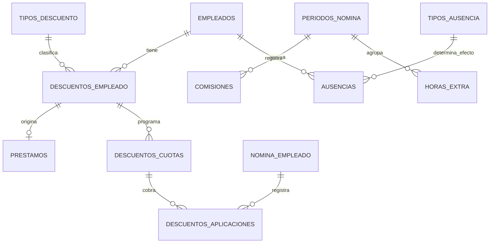

Captura y auditoría comparten transacción; los servicios comprueban saldos, traslapes y cierres.
La primitiva de cobro actualiza aplicaciones, cuota y acuerdo; saldo cero liquida el acuerdo.
El cálculo/reversión de nómina y los snapshots permanecen para Fase 8. Contrato: NOVEDADES.md.

## Extensión de vacaciones — FASE 7

V015 conserva las 53 tablas y añade `SALDO_INICIAL` a los tipos del kardex. Su CHECK permite
cero exclusivamente en la apertura y exige apertura no negativa. Un índice único condicional
impide más de una apertura por empleado. `CLAVE_ORIGEN` conserva la unicidad por empleado:
`MES:aaaa-mm-dd`, `SOLICITUD:id`, `TOMADAS:referencia` y `SALDO_INICIAL:referencia`.
Hay 16 migraciones V000–V015; no se reescribió ninguna migración anterior.

La solicitud de vacaciones crea su vínculo obligatorio con SOLICITUDES e historial desde el alta.
Aprobación/rechazo actualizan ambas tablas, historial, auditoría y notificaciones en la misma
transacción; aprobar añade un único DISFRUTE negativo. La apertura sustituye el saldo histórico
hasta su corte sin borrar movimientos. Detalles de cálculo e integración: VACACIONES.md.

## FASE 8 — Control del motor y apertura fiscal

V016 agrega HASH_FUENTES/ALERTAS JSON a PERIODOS_NOMINA y FORMATO_IGSS JSON a
CONFIGURACION_EMPRESA. Mantiene NOMINA_EMPLEADO/DETALLE/PARAMETROS/ISR_PROYECCIONES y
DESCUENTOS_APLICACIONES de V007, con versiones y aplicaciones reversibles. Índices funcionales
JSON para departamento/alerta conservados en el cálculo. S005 agrega ISR_DEVOLUCION sin
sobrescribir conceptos o parámetros operativos. Contrato/fórmulas: [NOMINA.md](NOMINA.md).

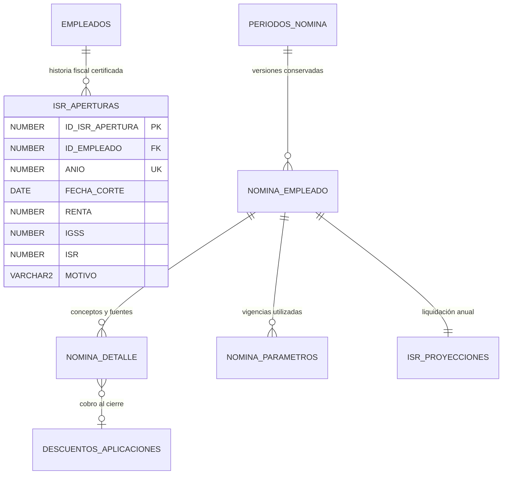

ISR_APERTURAS: identity ALWAYS, único (empleado,año), corte al final de una quincena del año,
montos NUMBER(12,2) no negativos, auditoría/ACTIVO/CHECK, FKs a empleado/creador/editor indexadas.
Se valida continuidad/no duplicación con cierres desde el servicio; no sustituye nóminas cerradas.

## FASE 9 — Instantáneas y liquidaciones (V017)

PRESTACIONES conserva `HASH_FUENTES`, `SNAPSHOT` (JSON CLOB), `APROBADO_POR` y `APROBADO_EN`.
Su snapshot incluye selección, empleado, empresa, entradas/versiones de nómina, parámetros,
componentes y huellas. PRESTACION_DETALLE conserva promedio, importe y exención por componente.
El índice único de ciclo omite ANULADA para permitir recalcular conservando historia; otro índice
único impide dos liquidaciones vigentes para el mismo empleado. FK de aprobador y filtros indexados.

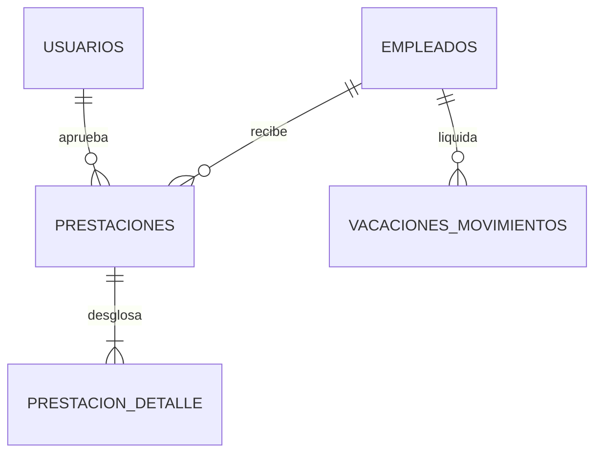

Finiquito usa TIPO=INDEMNIZACION y detalles INDEMNIZACION, VACACIONES_PENDIENTES, AGUINALDO y
BONO_14. El débito del kardex usa clave `FINIQUITO:id`. Nómina consume exenciones congeladas de
PRESTACION_DETALLE, también para componentes proporcionales de finiquito. Reapertura protege las
nóminas incluidas en `snapshot.nominas`. Continúan 54 tablas de negocio; no se modifican V000–V016.

## FASE 10 — Documentos privados transaccionales (V018)

`DOCUMENTOS_GENERADOS.CONTENIDO_PDF` añade el archivo BLOB junto con snapshots de plantilla y
variables, bytes y SHA-256. Un índice UNIQUE condicional limita a un documento vigente por solicitud;
se mantienen identidades, relaciones compuestas de propietario y restricciones de FASE 1.
`IX_SOLICITUDES_BANDEJA` cubre empleado/estado/fecha. No se agregan tablas: siguen 54 de negocio.

SOLICITUDES → SOLICITUD_HISTORIAL conserva creación, resolución y entrega; NOTIFICACIONES enlaza la
solicitud con cada destinatario y clave de evento única. DESCUENTOS_EMPLEADO.ID_SOLICITUD vincula el
parqueo FIJO creado al aprobar; su UNIQUE evita repetir el efecto. La propuesta de identidad guarda
original/nuevo en DATOS_SOLICITADOS, mientras el contacto modifica EMPLEADOS y el contacto principal.
Contrato y transacciones: [SOLICITUDES.md](SOLICITUDES.md). V000–V017 permanecen intactas.

## Fase 11 — Comunicación y agregación

V019 añade `ANUNCIOS.VERSION` y `EVENTOS.VERSION` (NUMBER(10), positivo, inicialmente 1) para
ediciones optimistas. Se conservan las 54 tablas de negocio y las relaciones de comunicación de V011.
Una versión reemplaza relaciones de audiencia; su estado previo completo se conserva en auditoría.
NOTIFICACIONES usa claves ANUNCIO:id:version / EVENTO:id:version y sus FK existentes; editar o retirar
una publicación desactiva avisos de versiones anteriores en la misma transacción.

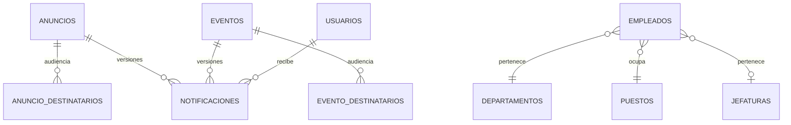

Índices V019: vigencias activas de anuncios, agenda activa, nómina por periodo/versión/activo,
empleados activos/estado/ingreso/departamento, notificaciones por usuario/activo/lectura/fecha,
bitácora por fecha/ID y sesiones por activo/revocación/expiración. Las agregaciones leen las mismas
tablas con snapshot READ ONLY; no se almacenan contadores ni datos de dashboard duplicados.

## Ajustes de cierre — V020

V020 incorpora índices de DIRECCION, REPRESENTANTE, CORREO y TELEFONO en CONFIGURACION_EMPRESA,
y `(ID_ROL, ACTIVO, CAMBIO_OBLIGATORIO, USUARIO)` en USUARIOS. NIT/usuario/correo conservan sus índices
UNIQUE. No modifica tablas, relaciones ni migraciones anteriores. Los filtros habilitados figuran
en `db/filtros.json`; `db:verify` comprueba sus índices y las 21 migraciones V000–V020.
CONFIGURACION_EMPRESA se administra desde el catálogo Datos de empresa; mantiene una sola empresa
activa. El formato IGSS existente y snapshots de documentos no se sobrescriben al editar sus datos.

## V1-3 — Identificadores automáticos (V021)

V021 conserva PK, FK y snapshots; renumera los once catálogos con código editable de v0,
`TIPOS_SOLICITUD`, empleados y las cinco entidades transaccionales indicadas en A4.
`CODIGO_ANTERIOR` conserva el valor previo; es nulo en entidades que no tenían código.
Los empleados se recorren por `FECHA_INGRESO, ID_EMPLEADO`. Las transacciones se numeran
por año de `FECHA_CREACION` y por fecha/id, incluyendo registros inactivos.

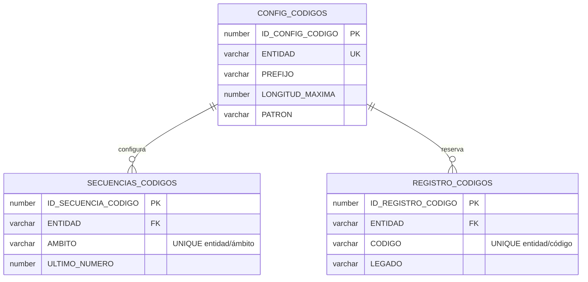

Estas tres tablas de infraestructura tienen identity ALWAYS, auditoría y FKs indexadas.
`N2_CODIGOS.ASIGNAR` crea el contador tolerando su creación simultánea, bloquea su fila
con `SELECT ... FOR UPDATE` y registra la reserva dentro de la transacción llamante.
No usa transacciones autónomas ni commits internos. El rollback revierte contador y reserva.
El ámbito es GENERAL para catálogos, ID de departamento para empleados y año para transacciones.
La reserva permanece tras eliminación física, impidiendo reutilización de identificadores.
Los triggers de las entidades asignan el código al insertar y prohíben modificarlo después,
independientemente del cliente. UNIQUE protege cada tabla; parámetros conserva UNIQUE por
código/vigencia, compartiendo identidad entre sus versiones.

Los parámetros tienen `CLAVE_INTERNA` inmutable: V021 copia su clave original y las altas
la derivan automáticamente del nombre completo normalizado (p. ej. Salario mínimo mensual →
SALARIO_MINIMO_MENSUAL). Sus nuevas vigencias heredan la clave y el código. Los cálculos
consultan esa clave; los tipos de trámite conservan la referencia semántica mediante
`NVL(CODIGO_ANTERIOR,CODIGO)`. Los seeds buscan también por dicha clave, conservando su idempotencia.
Los códigos de roles, conceptos de nómina, plantillas y las referencias oficiales de IGSS
no son identificadores introducidos por los formularios de A4 y conservan su significado.

## Ubicaciones de Guatemala — V022 (FASE V1-4)

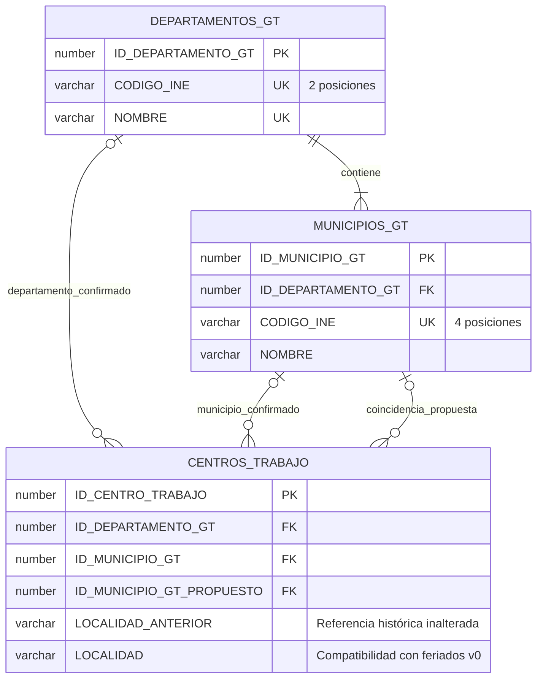

PK identity ALWAYS y códigos INE únicos; municipio único por departamento/nombre y por
par ID_MUNICIPIO_GT/ID_DEPARTAMENTO_GT. La FK compuesta de centros y CHECK ambos-nulos/o-ambos
impiden pares cruzados/parciales. Las referencias se admiten nulas para históricos pendientes;
la API exige ambas para altas/ediciones. Todas las FKs/filtros están indexados. Los dos catálogos
incluyen auditoría y ACTIVO, sin endpoints de escritura. S006 idempotente carga 22/340 desde
la fuente íntegra versionada en db/data/ine, conservando nombres y códigos del INE.

## V023 — Identidad privada y firma de documentos

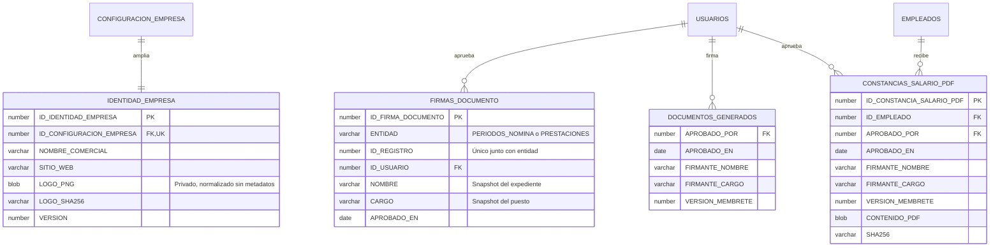

Las tres tablas incluyen auditoría y ACTIVO, PK identity ALWAYS y FKs indexadas. Se migra cada
configuración existente sin alterar sus claves ni FORMATO_IGSS. Las firmas históricas recuperables
usan el aprobador/fecha ya registrados y su expediente/puesto; no se inventan identidades faltantes.
Las plantillas activas se versionan, preservando originales y archivos emitidos. Las columnas
antiguas de firma quedan únicamente como datos históricos de la configuración; la aplicación ya
no las consulta ni las ofrece para captura. Las constancias de salario guardan archivo/huella y
aprobación en la misma transacción de auditoría. Los PDFs de solicitudes se versionan al reemitir.

## V1-6 — Horarios por bloques (V024)

```mermaid
erDiagram
    HORARIOS ||--o{ HORARIO_BLOQUES : contiene
    HORARIO_BLOQUES ||--|{ HORARIO_BLOQUE_DIAS : trabaja
    HORARIOS ||--o{ EMPLEADO_HORARIO : asignado
    EMPLEADOS ||--o{ EMPLEADO_HORARIO : conserva_vigencias
    HORARIO_BLOQUES {
        NUMBER ID_HORARIO_BLOQUE PK
        NUMBER ID_HORARIO FK
        NUMBER MINUTO_ENTRADA
        NUMBER MINUTO_SALIDA
        NUMBER CRUZA_MEDIANOCHE
        NUMBER MINUTOS_DESCANSO
    }
    HORARIO_BLOQUE_DIAS {
        NUMBER ID_HORARIO_BLOQUE_DIA PK
        NUMBER ID_HORARIO_BLOQUE FK
        NUMBER DIA_SEMANA
    }
```

Ambas tablas incluyen auditoría, ACTIVO, identities ALWAYS, CHECK e índices de FK/filtros.
UNIQUE bloque/día evita repetidos. V024 agrupa tiempos v0 idénticos y mantiene `HORARIO_DIAS`
como archivo; no cambia códigos, asignaciones, tiempos exactos, jornada histórica ni snapshots.
Las lecturas operativas expanden bloques/días y generan los descansos que no tienen bloque.
Para horas extra se suman los minutos efectivos de todos los bloques de cada día de entrada.
Los solapes y límites vigentes se verifican en servicio dentro del bloqueo común de catálogos y empleados.
Las 61 tablas de negocio quedan cubiertas por `db/filtros.json` y `db:verify`.

## V1-7 — Empleados automatizados (V025)

```mermaid
erDiagram
    DEPARTAMENTOS_GT ||--o{ EMPLEADOS : residencia
    MUNICIPIOS_GT ||--o{ EMPLEADOS : municipio_del_departamento
    USUARIOS |o--o| EMPLEADOS : acceso_automatico
    PARENTESCOS {
        NUMBER ID_PARENTESCO PK
        VARCHAR NOMBRE UK
        NUMBER ACTIVO
    }
    EMPLEADOS {
        NUMBER ID_DEPARTAMENTO_GT FK
        NUMBER ID_MUNICIPIO_GT FK
        NUMBER ZONA
        VARCHAR NUMERO_CASA
        VARCHAR DIRECCION_ANTERIOR
        VARCHAR SEXO_ANTERIOR
    }
    EMPLEADO_CONTACTOS_EMERGENCIA {
        VARCHAR PARENTESCO
        VARCHAR PARENTESCO_ANTERIOR
    }
    TIPOS_CONTRATO {
        NUMBER REQUIERE_FECHA_FIN
    }
```

PARENTESCOS contiene las 12 opciones A8, identity ALWAYS, auditoría, CHECK y FKs de actor indexadas.
El servicio valida el nombre exacto contra este catálogo de lectura; el texto histórico se conserva.
FK compuesta en EMPLEADOS impide cruzar municipio/departamento. Zona y casa tienen CHECK;
la API exige ubicación/casa y zona en 0101. DIRECCION se deriva para consumidores documentales v0.
No se asignan ubicaciones ficticias a históricos: DIRECCION_ANTERIOR conserva todo el texto.
SEXO_ANTERIOR preserva el valor original; antiguos O quedan pendientes (NULL), sin reinterpretarlos.
REQUIERE_FECHA_FIN es la bandera operativa; REQUIERE_FIN queda sincronizado por trigger como alias
para seeds/herramientas históricas. Obra determinada requiere fecha final en nuevas escrituras.
Las altas nuevas siempre vinculan usuario en la misma transacción. Históricos sin cuenta conservan
su vínculo previo. Contraseñas/PDF no se persisten; se devuelve solo la entrega inicial en memoria.
Las 62 tablas se verifican con db:verify; V000–V024 permanecen intactas.

## Vacaciones deterministas y cancelación — V1-8

V026 añade CANCELADO_POR (FK indexada a USUARIOS), CANCELADO_EN y MOTIVO_CANCELACION a
VACACIONES_SOLICITUDES. Conserva CREADO_POR/FECHA_CREACION y RESUELTO_POR/RESUELTO_EN:
cancelar no sobrescribe aprobación. SOLICITUDES admite CANCELADA; SOLICITUD_HISTORIAL registra
APROBADA → CANCELADA con actor/fecha/motivo. Los nuevos campos tienen CHECK de integridad.

VACACIONES_MOVIMIENTOS conserva ACUMULACION v0 como respaldo. AJUSTE MIGRACION_V1_8 compensa
diferencias al corte sin alterar solicitudes/snapshots/débitos. DISFRUTE SOLICITUD:id reserva al
aprobar; REVERSO CANCELACION:id devuelve exactamente el débito. UNIQUE empleado/clave protege
idempotencia. El saldo y los solicitables son derivados, sin nuevas tablas ni acumulación materializada.

## V1-9 — Novedades mensuales y suscripciones (V027–V028)

```mermaid
erDiagram
  EMPLEADOS ||--o{ NOVEDADES_MENSUALES : recibe
  NOMINA_EMPLEADO ||--o{ NOVEDADES_MENSUALES : aplica
  AUSENCIAS ||--o{ NOVEDADES_MENSUALES : desglosa_por_mes
  NOVEDADES_MENSUALES ||--o{ NOVEDADES_ORIGEN : conserva
  EMPLEADOS ||--o{ PARQUEO_SUSCRIPCIONES : solicita
  SOLICITUDES ||--o| PARQUEO_SUSCRIPCIONES : aprueba
  DESCUENTOS_EMPLEADO ||--o| PARQUEO_SUSCRIPCIONES : origen_v0
  PARQUEO_SUSCRIPCIONES ||--o{ NOVEDADES_MENSUALES : cargo_mensual
  PARQUEO_TARIFAS {
    number ID_PARQUEO_TARIFA PK
    varchar VEHICULO "CARRO o MOTO"
    number MONTO
    date VIGENTE_DESDE
    date VIGENTE_HASTA
  }
  PARQUEO_SUSCRIPCIONES {
    number ID_PARQUEO_SUSCRIPCION PK
    number ID_EMPLEADO FK
    number ID_SOLICITUD FK
    number ID_DESCUENTO_ORIGEN FK
    varchar VEHICULO "nullable solo legado por completar"
    varchar PLACA
    date MES_INICIO
    date MES_FIN "último mes cobrado completo"
    varchar ESTADO "ACTIVA, BAJA, SUSPENDIDA"
    number BAJA_SOLICITADA
    number MONTO_ANTERIOR "cuota v0 de referencia"
  }
  NOVEDADES_MENSUALES {
    number ID_NOVEDAD_MENSUAL PK
    number ID_EMPLEADO FK
    varchar TIPO "HORAS_EXTRA, COMISION, CONSUMO_TIENDA, AUSENCIA, PARQUEO"
    date MES "primer día del mes"
    number CANTIDAD "horas, días o unidad"
    number MONTO "nullable histórico aún sin valoración"
    number VALOR_UNITARIO
    number RECARGO
    varchar REFERENCIA
    varchar CLAVE_REFERENCIA UK "cargas v1: clase/empleado/mes/referencia; NULL legado"
    varchar DESCRIPCION
    varchar AUTORIZACION "preserva autorización v0 y de ausencias"
    varchar ESTADO "PENDIENTE o APLICADA"
    number ID_NOMINA_EMPLEADO FK
    number ID_AUSENCIA FK
    number ID_PARQUEO_SUSCRIPCION FK
  }
  NOVEDADES_ORIGEN {
    number ID_NOVEDAD_ORIGEN PK
    number ID_NOVEDAD_MENSUAL FK
    varchar ENTIDAD
    number ID_ORIGEN
  }
```

Las cuatro tablas tienen identity ALWAYS, auditoría, ACTIVO e índices de FK/filtros. Índices
UNIQUE condicionales evitan la colisión de claves parcialmente NULL en Oracle: cargo por
suscripción/mes, ausencia/mes/pago y horas pendientes por empleado/mes. V028 agrega CLAVE_REFERENCIA
para cargas v1 por clase/empleado/mes; las referencias históricas repetidas conservan su texto/origen.
La FK
compuesta (pago, empleado) impide aplicar una novedad a otra persona. Estado/pago tienen CHECK
coherente. SOLICITUDES añade VEHICULO/PLACA. Se agrega HORAS_EXTRA_TOPE_MENSUAL como parámetro
operativo vigente. V027 migra orígenes y snapshots sin alterar las tablas/migraciones anteriores;
los cobros de parqueo v0 conservan todas sus aplicaciones a través de NOVEDADES_ORIGEN.

## V1-10: identidad del pago y boleta archivada

```mermaid
erDiagram
  EMPLEADOS ||--o{ PAGOS_NOMINA : recibe
  PERIODOS_NOMINA ||--o{ NOMINA_EMPLEADO : contiene
  NOMINA_EMPLEADO ||--o| PAGOS_NOMINA : referencia_vigente
  NOMINA_EMPLEADO ||--o| BOLETAS_PAGO : archiva
  NOMINA_EMPLEADO ||--o{ NOVEDADES_MENSUALES : aplica
  PAGOS_NOMINA {
    number ID_PAGO_NOMINA PK
    number ID_EMPLEADO FK
    date MES "UNIQUE empleado-mes-tipo"
    string TIPO_PAGO "ANTICIPO o PAGO"
    number ID_NOMINA_EMPLEADO FK
    string ESTADO "PAGADO o REVERTIDO"
    string MOTIVO_REVERSION
    number REVERTIDO_POR
    date REVERTIDO_EN
  }
  BOLETAS_PAGO {
    number ID_BOLETA_PAGO PK
    number ID_NOMINA_EMPLEADO FK "UNIQUE"
    blob CONTENIDO_PDF
    string SHA256
  }
```

V029 agrega MOTOR V0/V1 a PERIODOS_NOMINA, PERIODICIDAD mensual/FECHA_FIN_ANTERIOR a descuentos
(incluidos préstamos) y FECHA_VENCIMIENTO_ANTERIOR a cuotas. Guarda PDFs y versiones anteriores al
revertir/reemitir un pago; la referencia UNIQUE se actualiza al volver a pagar. No altera snapshots v0.

## V1-11 — Prestaciones automáticas (V030)

```mermaid
erDiagram
  NOMINA_EMPLEADO ||--o| PRESTACIONES : acredita_pago_anual
  PRESTACIONES {
    number ID_PRESTACION PK
    number ID_NOMINA_EMPLEADO FK "nullable, UNIQUE; históricos conservados"
  }
```

PAGOS_NOMINA admite ANTICIPO, PAGO, BONO_14 y AGUINALDO conservando UNIQUE empleado/mes/tipo.
Las prestaciones anuales conservan fuente/detalle/exención y enlazan su boleta BLOB inmutable.
PRESTACIONES_DIAS_ANIO parametriza el divisor de proporcionalidad. No se modifica V000–V029.
