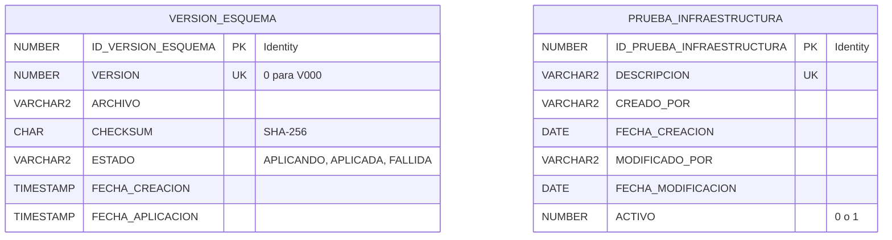

# Esquema técnico — FASE 0

Solo hay infraestructura. El modelo de nómina se definirá en una fase posterior.
Ambas tablas pertenecen al usuario dedicado de aplicación en XEPDB1 y no tienen relación entre sí.

`VERSION_ESQUEMA` es metadata técnica administrada por el runner. Sus fechas incluyen zona horaria
y no usa eliminación lógica: el historial es permanente. La tabla de prueba sigue las convenciones
de auditoría del proyecto, con `CREADO_POR` como usuario Oracle durante esta fase sin autenticación.
