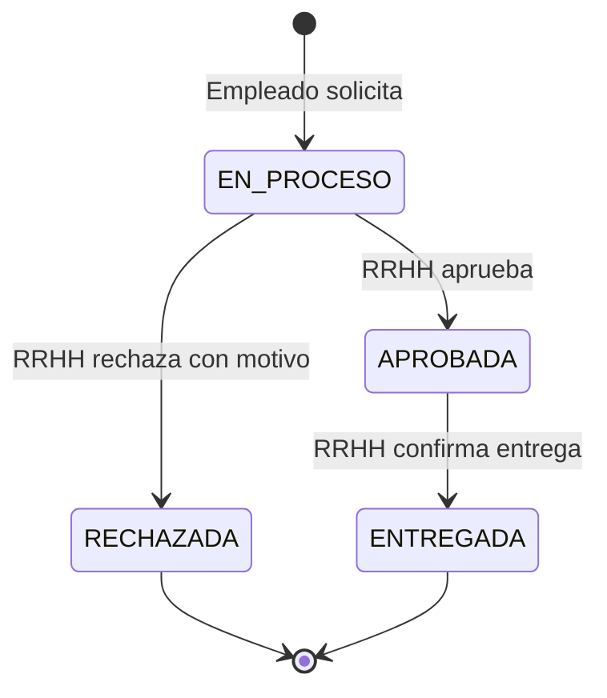

# Gestiones del empleado — FASE 10

El empleado abre `/mis-gestiones` para solicitar constancia laboral, certificado IGSS,
constancia INTECAP, gafete o parqueo, consultar sus solicitudes y descargar documentos entregados.
Boletas y vacaciones abren sus módulos existentes. `/mis-gestiones/datos` permite actualizar
contacto directamente o proponer cambios de nombres, apellidos, DPI, NIT y estado civil.
RH/ADMIN abre `/solicitudes` para resolver la bandeja y editar plantillas.

## Estados y transacciones

Rechazada es terminal: el empleado puede enviar otra solicitud corregida. No se permite entregar
un rechazo, aprobar dos veces ni tener dos solicitudes del mismo tipo en proceso. Los estados,
historial, auditoría, PDF y notificaciones se confirman o revierten juntos. Los locks siguen el orden
compartido de catálogos/usuarios/periodos y revalidan sesión y rol dentro de la transacción.
Vacaciones conserva su servicio y reglas independientes; no se resuelve desde la bandeja genérica.

## Documentos y plantillas

Aprobar un documento obtiene la plantilla vigente de mayor versión y los datos reales del empleado,
salario vigente y empresa. Sustituye variables literalmente y genera PDFKit: no interpreta HTML,
JavaScript ni expresiones. Un dato requerido por la plantilla que esté vacío impide aprobar.
Las tres plantillas iniciales provienen de S004; RRHH debe revisar el texto y completar los datos
reales de empresa/representante/afiliación antes del uso operativo.

Variables: `{{nombre}}`, `{{dpi}}`, `{{nit}}`, `{{puesto}}`, `{{departamento}}`, `{{fecha_ingreso}}`,
`{{salario}}`, `{{afiliacion_igss}}`, `{{empresa}}`, `{{nit_empresa}}`, `{{direccion_empresa}}`,
`{{representante}}`, `{{fecha_emision}}`. La edición requiere motivo, confirmación y versión actual.
Se inserta una nueva versión efectiva hoy; las anteriores se conservan. No se editan snapshots.

V018 añade `DOCUMENTOS_GENERADOS.CONTENIDO_PDF` BLOB transaccional y un índice que permite un solo
archivo vigente por solicitud. Guarda texto original, variables aplicadas, plantilla/versionado,
nombre, bytes y SHA-256; `RUTA_PRIVADA` es un identificador interno, nunca una URL pública.
La entrega exige el SHA-256 de la vista previa vigente. Se publica exactamente el archivo revisado,
sin regenerarlo con datos o plantillas posteriores. La descarga vuelve a verificar su integridad.

El visor propio usa PDF.js 5.5.207 (fijado, compatible con Node 20; `npm audit` sin avisos), carga
diferida, páginas anterior/siguiente, ampliación, texto accesible y descarga. La entrega solo se
habilita después de renderizar la vista previa. No requiere un visor PDF nativo ni servicios externos.
Gafete, parqueo y actualización de datos se entregan mediante confirmación manual, sin PDF.
Los certificados son constancias empresariales según la plantilla, no trámites ante entidades externas.

## Parqueo y datos personales

Al aprobar parqueo, RH indica monto positivo por quincena y fecha de inicio hoy/futura, dentro de
la relación laboral y posterior a cualquier periodo cerrado. No se inventa tarifa ni se toma de
un dato enviado por el empleado. RH confirma que comunicó el importe al empleado.
`registrarParqueo` del módulo Fase 6 crea `DESCUENTOS_EMPLEADO` FIJO/VIGENTE, vinculado de forma única
a la solicitud. Usa el tipo PARQUEO activo; nómina lo consume con sus reglas actuales, incluido
bloqueo por neto negativo. Otro parqueo vigente que alcance la fecha inicial impide duplicarlo.
La baja/modificación del descuento se administra con las restricciones de Novedades.

Contacto directo: teléfono, dirección, correo del expediente y contacto principal de emergencia.
Se valida y audita todo; no cambia el correo de acceso de USUARIOS. El contacto principal se inserta
si faltaba. La propuesta crítica conserva valores originales y nuevos: aprobar revalida el original,
valida unicidad y aplica todo atómicamente. Si el expediente cambió, se exige rechazar y solicitar de
nuevo; un rechazo conserva los datos actuales. Nunca permite cambiar salario, rol o cuenta bancaria.

## API

Todos los endpoints exigen sesión, cambio de contraseña completado y CSRF para escrituras.
Zod estricto rechaza campos ajenos. Las respuestas mantienen `{ ok, data }`.

| Método y ruta `/api`                    | Permiso / operación                                                              |
| --------------------------------------- | -------------------------------------------------------------------------------- |
| `GET /solicitudes`                      | Propias para EMPLEADO; todas para RH/ADMIN                                       |
| `POST /solicitudes`                     | EMPLEADO: tipo, observaciones, datos críticos cuando corresponda, confirmado     |
| `GET /solicitudes/:id`                  | Propiedad / detalle e historial                                                  |
| `POST /solicitudes/:id/resolver`        | RH/ADMIN: APROBADA/RECHAZADA, motivo, confirmado; parqueo con monto/fechaInicio  |
| `GET /solicitudes/:id/documento`        | RH/ADMIN: preview; EMPLEADO: solo propio entregado; base64, mime, nombre, sha256 |
| `POST /solicitudes/:id/entregar`        | RH/ADMIN: confirmado y sha256 para documentos                                    |
| `GET /solicitudes/mis-datos`            | Solo EMPLEADO: datos propios derivados de su sesión                              |
| `PATCH /solicitudes/mis-datos/contacto` | Solo EMPLEADO: contacto validado                                                 |
| `GET /solicitudes/plantillas`           | RH/ADMIN: contenido/versiones actuales y variables                               |
| `PATCH /solicitudes/plantillas/:tipo`   | RH/ADMIN: contenido, version, motivo, confirmado                                 |
| `GET /solicitudes/exportar`             | CSV completo, respeta propiedad/filtros; hasta 10,000 filas                      |
| `GET /notificaciones`                   | Contador propio y últimos 30 avisos de todos los módulos                         |
| `POST /notificaciones/:id/leida`        | Marcado idempotente, condicionado al propietario                                 |

Listado: `tipo`, `estado`, `idEmpleado`, `buscar` (nombre/código), `desde`, `hasta` (creación inclusive),
`pagina`, `limite` (hasta 100), `ordenarPor` (id/empleado/tipo/estado/fecha), `direccion` (asc/desc).
Listados y CSV excluyen DPI, NIT y propuestas críticas. Aun con `idEmpleado` ajeno, EMPLEADO solo
puede consultar lo propio. La campana conserva compatibilidad con avisos existentes de vacaciones.

## Verificación

1. `docker compose up --build` aplica V018 y conserva volumen/credenciales; no hay nuevos seeds.
2. HTTP local: Node 20 y `NODE_ENV=development npm run dev`; completar referencias/empresa reales.
3. Empleado solicita constancia; RH abre aviso/bandeja, aprueba, revisa PDF y entrega.
4. Empleado abre el aviso de entrega y descarga el PDF. Probar también gafete, parqueo y Mis datos.
5. Probar rechazo sin motivo, solicitudes ajenas, aprobación concurrente, cambio de plantilla y
   cambio de expediente mientras existe una propuesta; verificar historial/auditoría/notificaciones.
6. `npm run lint`, `npm test`, `npm run typecheck`, `npm run build`, `npm run format:check`.
7. `npm run verify:solicitudes`, `npm run verify:security`, `npm run verify:prestaciones`,
   `npm run db:verify`, `npm run verify:infra`. Para Oracle con Node 20: construir imagen
   `nomina2-security-tests` y ejecutar `npm run verify:solicitudes -- --docker`.

La suite usa exclusivamente N2SEC desechable y prueba sesiones/cookies/CSRF reales, flujo completo,
propiedad, concurrencia, PDFs y snapshots inmutables, filtros/CSV, parqueo consumible por nómina,
contacto/datos críticos y fallos de auditoría que revierten aprobación/entrega/efectos económicos.
